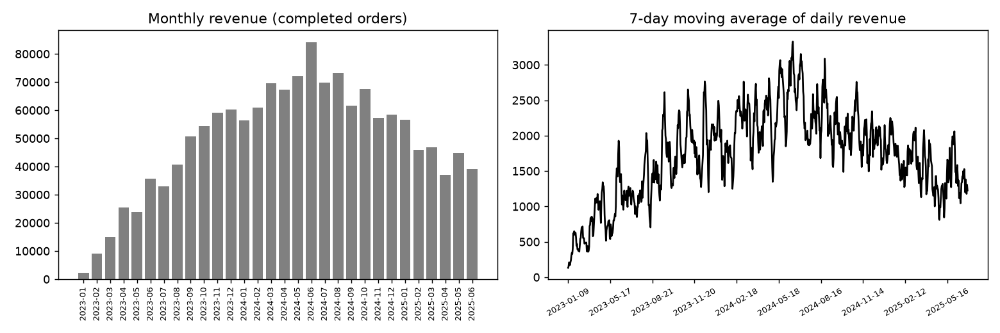

# sql-analytics-warehouse

Small SQLite warehouse with analytical SQL: window functions, ranking, retention and market-basket queries.

## Task

Show analytical SQL on a realistic star-like schema (customers, products, orders, order items) and keep the queries tested.

## Approach

- `src/data.py` creates the schema with keys and indexes and fills it with generated data.
- `queries/` holds five standalone SQL files: monthly revenue and margin with `LAG`, top customers per country with `RANK` and share of total, running total with a 7-day moving average, 90-day repeat purchase rate by signup quarter, and frequently bought together pairs with lift.
- `src/core.py` runs a query by name and returns a DataFrame; tests check results against direct sums and integrity constraints.

## Results



- Tables: customers 1,500, products 60, orders 5,061, order_items 12,658.
- 30 months covered, best month 2024-06.
- Average 90-day repeat purchase rate 43%.
- Most frequent pair: item_025 and item_044 (17 orders).

## Run

```bash
pip install -r requirements.txt
python run.py      # generates data, runs the analysis, writes reports/
pytest             # unit tests
```

## Layout

```
src/data.py     data generation (fixed seed, no downloads)
src/core.py     analysis / model code
run.py          end-to-end script
tests/          unit tests
reports/        figures and summary.json produced by run.py
```

## Notes

The data is generated by `src/data.py` with a fixed random seed, so the numbers above are reproducible. It is synthetic: it is meant to show the method, and results on real data will differ.

Stack: SQLite, pandas, matplotlib.
